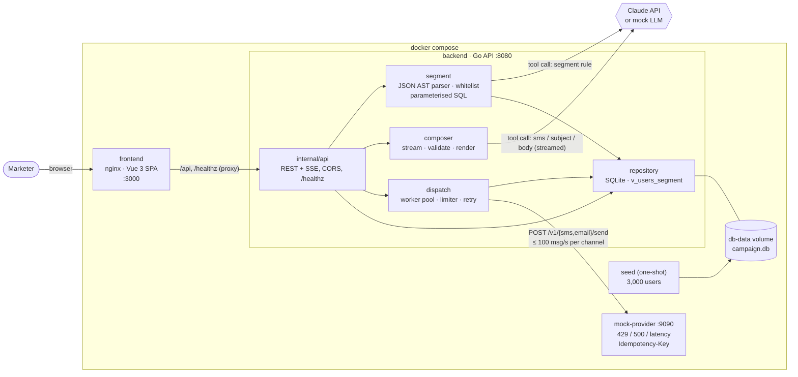

# Smart Campaign Composer

> Insider One · AI Developer Case Study · 2026

A marketer types what they want in plain Turkish; Claude proposes **who** should receive it and **what** the SMS and e-mail should say; the marketer reviews, edits and approves; the system delivers it through a rate-limited, retrying, idempotent queue and shows progress live.

> *"Son 30 günde sepetine ürün ekleyip alışveriş yapmayan İstanbul'daki kullanıcılara %30 indirim hatırlatması gönder. Samimi ama kısa olsun."*

| Layer | Choice |
|---|---|
| Backend | Go 1.24, standard-library `net/http`, SQLite via pure-Go `modernc.org/sqlite` |
| Frontend | Vue 3 (Composition API), Vite, Tailwind CSS v4, served by nginx |
| LLM | Claude via the Anthropic Messages API (forced tool calls → JSON), or a deterministic mock |
| Delivery | In-process worker pool → mock SMS / e-mail provider over HTTP |

Design decisions and their trade-offs are recorded in [`DECISIONS.md`](DECISIONS.md) (ADR 001–011); each backend package has its own README.

---

## Contents

1. [Quickstart (Docker)](#quickstart-docker)
2. [Architecture](#architecture)
3. [Safety & reliability mechanisms](#safety--reliability-mechanisms)
4. [Tests](#tests)
5. [Local development without Docker](#local-development-without-docker)
6. [Configuration (`.env.example`)](#configuration-envexample)
7. [API](#api)
8. [Scope & trade-offs](#scope--trade-offs)
9. [Repository layout](#repository-layout)
10. [AI usage](#ai-usage)

---

## Quickstart (Docker)

**Requirements:** Docker Engine 24+ with Compose v2 (Docker Desktop on Windows / macOS works). Nothing else: no Go, Node, database or API key.

```bash
git clone https://github.com/erkerem2/smart-campaign-composer.git
cd smart-campaign-composer
docker compose up --build          # or: make up
```

The first build downloads the base images and dependencies (a few minutes); later starts take seconds. When every service is healthy:

| Service | URL | What it is |
|---|---|---|
| **Frontend** | <http://localhost:3000> | The campaign wizard (nginx + Vue build, proxies `/api` and `/healthz`) |
| **Backend API** | <http://localhost:8080/healthz> | Go API; health of the database, the provider and the LLM mode |
| **Mock provider** | <http://localhost:9090/v1/stats> | Fake SMS / e-mail gateway; per-channel counters of what it accepted |

What happens on `docker compose up`:

```
mock-provider ── healthy ─────────┐
seed ─── migrate + 3,000 users ───┼──► backend ── healthy ──► frontend
         (exits 0; no-op if the   │    (/healthz)            (nginx)
          volume already has      │
          users)                  │
db-data volume (SQLite) ──────────┘
```

1. `seed` migrates the schema and inserts 3,000 deterministic fake users into the `db-data` volume, then exits. It is idempotent: on later starts it sees the users and exits immediately.
2. `mock-provider` starts and must answer `/healthz`.
3. `backend` starts only after the seed **completed successfully** and the provider is **healthy**; its own healthcheck fails if the database or the segment view is broken.
4. `frontend` starts once the API is healthy.

**Try it:** open <http://localhost:3000>, keep the sample brief, click through *Brief → Kitle → Mesajlar → Onay → Gönderim*. Without an API key the backend runs the **mock LLM** (the health badge in the header says *Mock LLM*): every brief gets the reference segment rule and message, streamed with a typing effect, so the full flow — including ~10% `429`s and ~5% `500`s from the provider, retries and the 100 msg/s cap — can be watched end to end at zero cost.

**Use real Claude:**

```bash
cp .env.example .env               # set ANTHROPIC_API_KEY=sk-ant-...
docker compose up -d                # recreates the backend with the key
```

Compose reads `.env` for variable substitution only; the key is passed to the `backend` container and nowhere else.

**Useful commands**

| Command | Effect |
|---|---|
| `make up` / `make up-d` | Build and start (foreground / detached) |
| `make logs` · `make ps` | Follow logs · show service health |
| `make docker-reseed` | Wipe users, campaigns and dispatch logs and seed 3,000 fresh users (dates are relative to *now*, so re-seed if the volume is weeks old) |
| `make down` | Stop and remove containers, keep the data |
| `make docker-clean` | Remove containers **and** the database volume |
| `make test-docker` | Run the Go and Vitest suites inside the build images (no local toolchain) |

All ports are published on `127.0.0.1` only. Ports clash? Set `FRONTEND_PORT`, `BACKEND_PORT` or `MOCK_PROVIDER_PORT` in `.env`.

---

## Architecture



### The five steps of a campaign

```
 1. Audience     brief ──► Claude (tool: segment rule JSON) ──► parser + whitelist ──► canonical AST
                 AST ──► compiler (?-placeholders only) ──► v_users_segment ──► count + SMS/e-mail opt-ins
 2. Content      brief ──► Claude (tool: sms_content, email_subject, email_body)
                 input_json_delta ──► per-field deltas ──► SSE ──► typing effect in the UI
                 final JSON ──► validator (160 / 80 code points, variables, markup) ──► 1 repair round ──► draft
 3. Approval     marketer edits ──► POST /api/campaigns ──► rule + content re-validated server-side
                 ──► campaign + messages written as `approved` in one transaction
 4. Dispatch     stored rule re-validated ──► recipients resolved now ──► one `pending` row per
                 (campaign, user, channel) claimed with opt-in check ──► per-channel queue
                 ──► limiter (100/s) ──► provider (Idempotency-Key) ──► retry 429/5xx with backoff
 5. Tracking     lock-free counters ──► SSE every 500 ms + GET snapshot ──► live dashboard
```

**Request path for the UI:** browser → nginx (`:3000`) → `backend:8080`. nginx serves the static build and proxies `/api` and `/healthz` with buffering disabled and a 1 h read timeout, so both SSE streams (compose and dispatch) arrive token by token. The browser only ever talks to one origin, so CORS never applies in this setup.

---

## Safety & reliability mechanisms

### 1. LLM output is data, never code — safe JSON AST instead of SQL (ADR 005, 008)

Claude never writes SQL. It is forced to call a tool whose input is a **rule tree**:

```json
{"type":"group","logic":"AND","rules":[
  {"type":"condition","field":"city","operator":"EQUALS","value":"İstanbul"},
  {"type":"condition","field":"cart_last_active_days","operator":"LESS_THAN_OR_EQUAL","value":30},
  {"type":"condition","field":"has_purchased_since_cart","operator":"EQUALS","value":false}]}
```

- The parser accepts only **whitelisted fields** (`city`, `age`, `total_spend`, `cart_last_active_days`, `has_purchased_since_cart`), each with its own operators, type and value range; logic `AND` / `OR` / `NOT`; limits of depth 4, 20 conditions, 50 list items, 16 KB. Unknown fields, operators or keys are rejected — not ignored.
- City names are normalised (Turkish case folding `I/İ/ı`, diacritics, aliases for all 81 provinces), so `istanbul` and `Istanbul` match `İstanbul`.
- The SQL compiler emits column names **only from Go constants** and every value as a `?` placeholder (placeholder/argument parity is fuzz-tested).
- Queries run against the view `v_users_segment`, which derives time-relative attributes and **contains no PII** (no name, e-mail or phone), so even a compiler bug could not select them.
- The rule is validated again on approval and again at dispatch time — the database is not trusted with SQL either.

### 2. Channel limits and content validation (ADR 006)

- SMS ≤ **160** and e-mail subject ≤ **80** Unicode code points, checked on the template *and* on an estimated rendered length (`{{first_name}}` ≈ 10), and once more on the real text per recipient.
- Only whitelisted variables (`{{first_name}}`, `{{last_name}}`); single-line subjects (header injection); control and bidi-override characters rejected; the e-mail body is Markdown or a small whitelisted HTML subset.
- An invalid draft is sent back to Claude **once** with the issues; if it still fails, the marketer fixes it — no unbounded loops.
- The UI counters mirror the server's counting rules exactly, but approval is always re-validated by the API.

### 3. 100 msg/s per channel, exponential backoff with jitter (ADR 007)

- One **limiter per channel**, shared by all campaigns, and **every attempt — retries included — takes a slot**. A token bucket smooths the pace; a sliding-window log of the last 100 grants makes the cap hard in *any* one-second window (a token bucket alone allows `limit + burst`). A 50 ms safety margin keeps the cap true as observed by the provider; the end-to-end test asserts it on the provider's arrival timestamps.
- `429`, `408`, `5xx` and transport errors are retried up to **3** times: exponential backoff (base 200 ms, cap 5 s) with **equal jitter** (`[exp/2, exp)`), and `Retry-After` honoured as a floor. Other `4xx` fail immediately; each attempt has a 5 s timeout.
- 16 workers per channel per run; channels proceed in parallel.

### 4. No duplicates and no send without permission (ADR 003, 007)

- **Database-level idempotency:** `dispatch_logs` has `UNIQUE(campaign_id, user_id, channel)`. Before any provider call a `pending` row is *claimed* with `INSERT … ON CONFLICT DO NOTHING`; only the caller whose insert created the row may send. Final states are written with `UPDATE … WHERE status = 'pending'`, so they are never overwritten.
- **Provider-level idempotency:** every attempt carries `Idempotency-Key: campaign_id:user_id:channel`. If the outcome of an attempt is unknown (timeout after the provider accepted, crash), the retry or a later resume gets the original result back instead of a second message.
- **Two-phase opt-in check:** the loaded user must have the channel's opt-in (`User.CanReceive`), and the claim SQL itself repeats `AND opt_in_<channel> = 1`, so a user who opts out between audience resolution and sending is not claimed. On resume, pending rows of users who opted out meanwhile are closed as `failed`, never sent.
- A campaign starts with a compare-and-set (`approved → sending`), so two clicks or two processes cannot both send it. A restart leaves it `sending`; calling dispatch again **resumes** with the same keys.

### 5. Operability

- `GET /healthz` checks the database (including a query on the segment view) and the provider in parallel within 2 s. Only the database makes it `503`; a provider outage reports `degraded` because dispatch retries through it. Docker's healthchecks use this endpoint.
- Graceful shutdown: HTTP drains for 10 s, running dispatches stop cleanly and still record results the provider already accepted.
- Containers run as an unprivileged user; binaries are static (`CGO_ENABLED=0`).

---

## Tests

```bash
make test            # Go: all backend packages
make test-frontend   # Vitest: 61 frontend tests (needs `make frontend-install` once)
make test-all        # both
make test-docker     # both, inside the Docker build images — only Docker required
make test-e2e        # just the HTTP end-to-end flow, verbose
```

**Zero cost, zero network, zero keys.** Every external call sits behind an interface (`segment.LLMClient`, `composer.MessageLLMClient`, the provider client), and the tests use:

- **Mock LLM clients** that return fixed rule trees and message JSON — including streamed fragments split inside escapes, surrogate pairs and UTF-8 sequences, invalid drafts that trigger the repair round, and transport errors. No test reads `ANTHROPIC_API_KEY`.
- **The real mock provider in-process** (`httptest`) at its default chaos: ~10% `429` with `Retry-After`, ~5% `500`, 10–30 ms latency.
- **The real seed** (3,000 users) inserted into SQLite in a temp directory, with Go oracles that recompute the expected audience independently of SQL.

Highlights:

| Test | What it proves |
|---|---|
| `TestEndToEndCampaignFlow` (`internal/api`) | Brief → preview → streamed content → 7 kinds of invalid approval rejected → dispatch over HTTP at the real rate limit; the provider received each idempotency key once, only audience members with opt-in, never more than 100 per second per channel |
| `internal/segment` | Parser rejects unknown fields/operators/keys, limits, type and range errors; SQL placeholder parity under fuzzing; audience counts on the real seed equal a Go oracle |
| `internal/composer` | 160 / 80 limits at code-point level, variable whitelist, markup whitelist, incremental JSON extraction at every split point, bounded repair |
| `internal/dispatch` | Limiter cap in any window, backoff/jitter bounds, `Retry-After`, claim-before-send, resume without duplicates, opt-out between plan and send |
| `frontend/tests` | SSE parser at every chunk boundary, counter parity with the server, wizard state machine, dispatch stream with polling fallback |

`make test-race` (in `backend/`) runs the suite with the race detector; it needs CGO and a C compiler, so it is not part of the default target.

---

## Local development without Docker

Requirements: Go 1.24+, Node 20.19+ (or 22.12+), `make`. No C compiler — the SQLite driver is pure Go.

```bash
cp .env.example .env        # optional: ANTHROPIC_API_KEY
make seed                   # backend/data/campaign.db with 3,000 users
make mock-provider          # terminal 1 → :9090
make run                    # terminal 2 → API on :8080
make frontend-install       # once
make frontend-dev           # terminal 3 → http://localhost:5173 (Vite proxies /api to :8080)
```

`make reseed` wipes and re-seeds the local database.

---

## Configuration (`.env.example`)

Copy to `.env`; it is git-ignored. Docker Compose uses it for variable substitution, and the local `make run` loads it without overriding variables already set in the environment.

| Variable | Default | Used by | Meaning |
|---|---|---|---|
| `ANTHROPIC_API_KEY` | *(empty)* | backend | Empty → deterministic mock LLM; set → real Claude |
| `ANTHROPIC_MODEL` | `claude-sonnet-5-5` | backend | Model for both segment and content calls |
| `PROVIDER_URL` | `http://localhost:9090` | backend (local) | Provider base URL; Compose fixes it to `http://mock-provider:9090` |
| `HTTP_ADDR` | `:8080` | backend (local) | API listen address |
| `DB_PATH` | `data/campaign.db` | backend, seed (local) | SQLite file; Compose fixes it to `/data/campaign.db` on the volume |
| `CORS_ALLOWED_ORIGINS` | local dev origins | backend | Comma-separated origins or `*`; not needed behind nginx |
| `MOCK_STREAM_DELAY_MS` | `15` | backend | Mock LLM only: delay between streamed fragments |
| `FRONTEND_PORT` / `BACKEND_PORT` / `MOCK_PROVIDER_PORT` | `3000` / `8080` / `9090` | compose | Published host ports |
| `MOCK_RATE_LIMITED_RATIO` | `0.10` | mock provider | Share of `429` responses |
| `MOCK_SERVER_ERROR_RATIO` | `0.05` | mock provider | Share of `500` responses |
| `MOCK_MIN_LATENCY` / `MOCK_MAX_LATENCY` | `10ms` / `30ms` | mock provider | Simulated latency |
| `MOCK_RETRY_AFTER` | `1s` | mock provider | `Retry-After` on `429` |

`frontend/.env.example` covers the Vite dev server (`VITE_API_TARGET`, `VITE_API_BASE`).

---

## API

| Method & path | Purpose |
|---|---|
| `GET /healthz` | Health of database and provider, uptime, active dispatches, LLM mode |
| `POST /api/campaigns/preview-segment` | `{brief}` → Claude rule, validated canonical AST, counts; or `{rule}` → re-count an edited rule without calling the LLM |
| `POST /api/campaigns/compose/stream` | SSE: `delta` per field, `retry` with issues, `done` with the validated draft, or `error` with the rejected attempt |
| `POST /api/campaigns` | Approve: rule + content re-validated, stored as `approved` atomically |
| `GET /api/campaigns/{id}` | Campaign with rule and messages |
| `POST /api/campaigns/{id}/dispatch` | Start (or resume) delivery, `202`; `409` if already running |
| `GET /api/campaigns/{id}/dispatch` | Snapshot of per-channel stats |
| `GET /api/campaigns/{id}/dispatch/stream` | SSE: stats every 500 ms, then `done` |

Errors share one shape: `{"error": {"code", "message", "path?", "issues?"}}`. Details: [`backend/internal/api/README.md`](backend/internal/api/README.md).

---

## Scope & trade-offs

As the case suggests, the core flow was made solid end to end before anything optional. Deliberately **not** done:

| Not done | Why / what it would take |
|---|---|
| **Scheduled sending** (bonus) | Needs a `scheduled_at` on campaigns and a ticker that calls the existing `Start`; the dispatch engine is already resumable and idempotent, so it is an additive change |
| **A/B variants** (bonus) | Would add a variant column to messages and a deterministic user → variant split; tracking would need per-variant counters |
| **Content in the user's language** (bonus) | The seed has no language attribute; the composer would generate one draft per language and the renderer pick per user. UI copy is Turkish only (no i18n layer) |
| **CI pipeline** (bonus) | `make test-docker` is the job a CI runner would execute; a Playwright run against `docker compose` is the natural browser E2E step |
| Authentication, multi-tenancy | Out of the case's scope; would sit in the existing middleware chain |
| Campaign list / reload recovery | The UI tracks the campaign it created; a reload loses wizard state although dispatch continues server-side (`GET /api/campaigns` + deep link would restore it) |
| Durable queue, horizontal scale | SQLite has one writer and the queue is in-process — right for thousands of recipients at 100 msg/s; millions would move to Postgres (`SKIP LOCKED`) or a broker behind the same `dispatch` ports |
| SMS encoding segments | The case's 160-character rule is enforced; real carriers bill GSM-7 vs UCS-2 segments (most Turkish letters force UCS-2) |
| Rendered e-mail HTML preview | The preview shows the source as text; rendering would require a sanitiser identical to the server's whitelist |
| Strict "no purchase in 30 days" reading | The sample brief is interpreted as *no purchase since the last cart activity* (ADR 008); the strict variant needs a `last_purchase_days` field |

---

## Repository layout

```
.
├── docker-compose.yml        one-command setup (ADR 011)
├── Makefile                  test / run / docker shortcuts
├── .env.example
├── DECISIONS.md              architecture decision records 001–011
├── CASE_SPEC.md              the case brief
├── ai-sessions/              links to the Claude sessions used to build this
├── backend/
│   ├── Dockerfile            multi-target: server · seed · mock-provider · test
│   ├── cmd/
│   │   ├── server/           HTTP API
│   │   ├── seed/             3,000 deterministic fake users
│   │   └── mock-provider/    fake SMS / e-mail gateway
│   └── internal/
│       ├── api/              REST + SSE handlers, CORS, health
│       ├── segment/          rule AST, parser, whitelist, SQL compiler, Anthropic client
│       ├── composer/         prompt, streaming extractor, validator, renderer
│       ├── dispatch/         planner, worker pool, limiter, backoff, stats
│       ├── provider/         mock provider + HTTP client
│       ├── repository/       SQLite schema, migrations, repositories
│       ├── domain/           entities and invariants
│       ├── seed/             cohort-based generator
│       └── config/           env + .env loading
└── frontend/
    ├── Dockerfile            Vite build → nginx (+ test target)
    ├── nginx/                reverse-proxy template (/api, /healthz, SSE)
    ├── src/                  steps, UI components, composables, SSE client
    └── tests/                Vitest suites
```

---

## AI usage

The project was built with Claude as a pair programmer. The session exports are listed in [`ai-sessions/`](ai-sessions/README.md); every decision the generated code embodies is written down in `DECISIONS.md` with the reasoning and the test that pins it.
